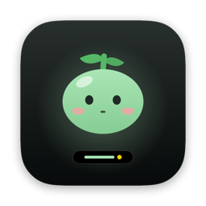
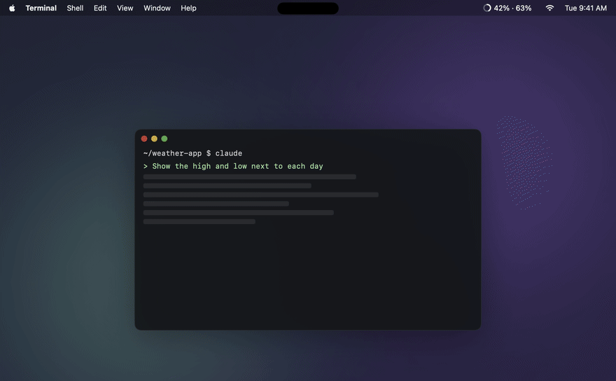
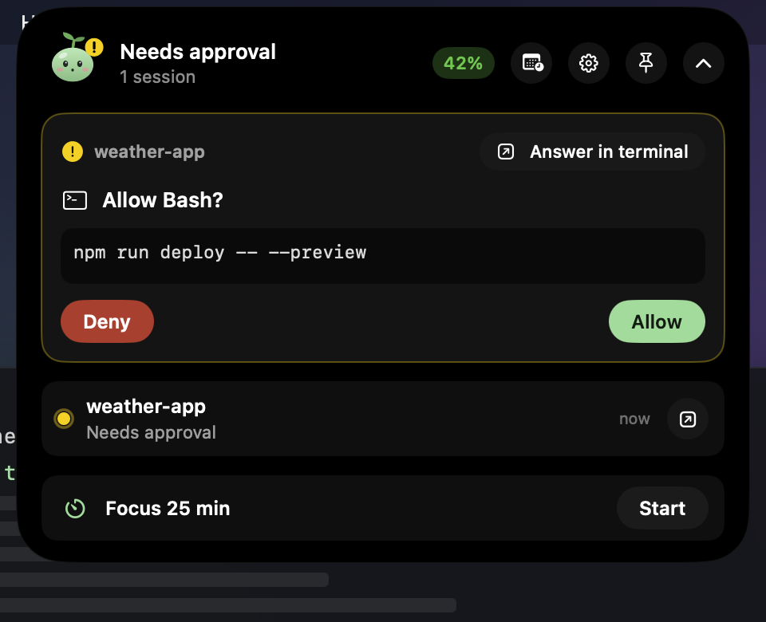
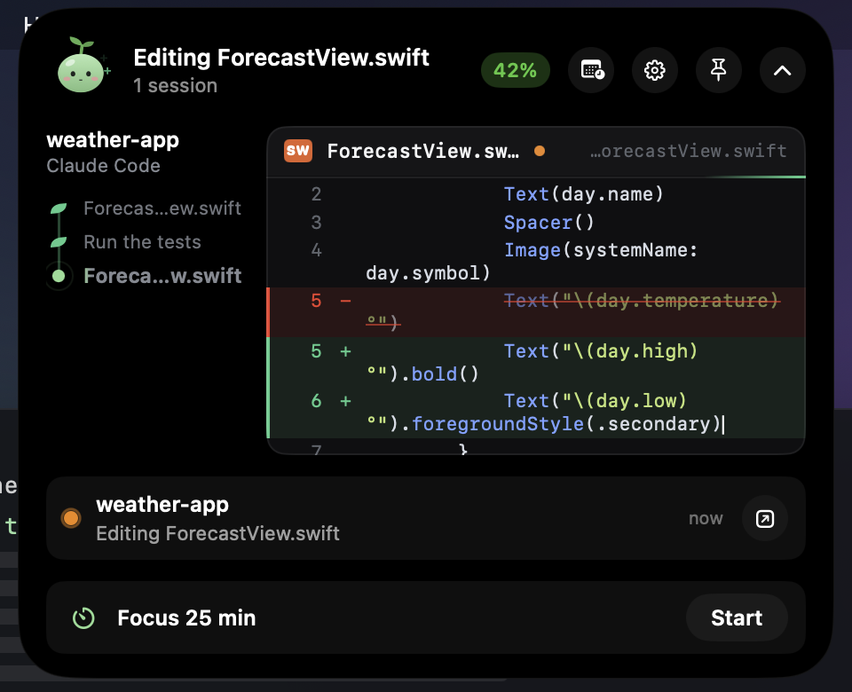
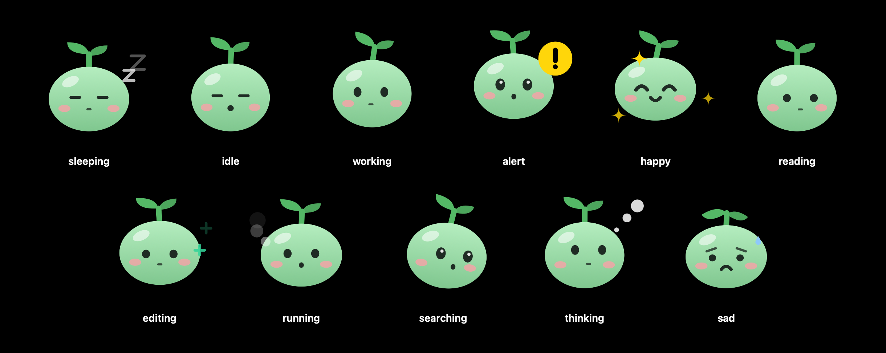
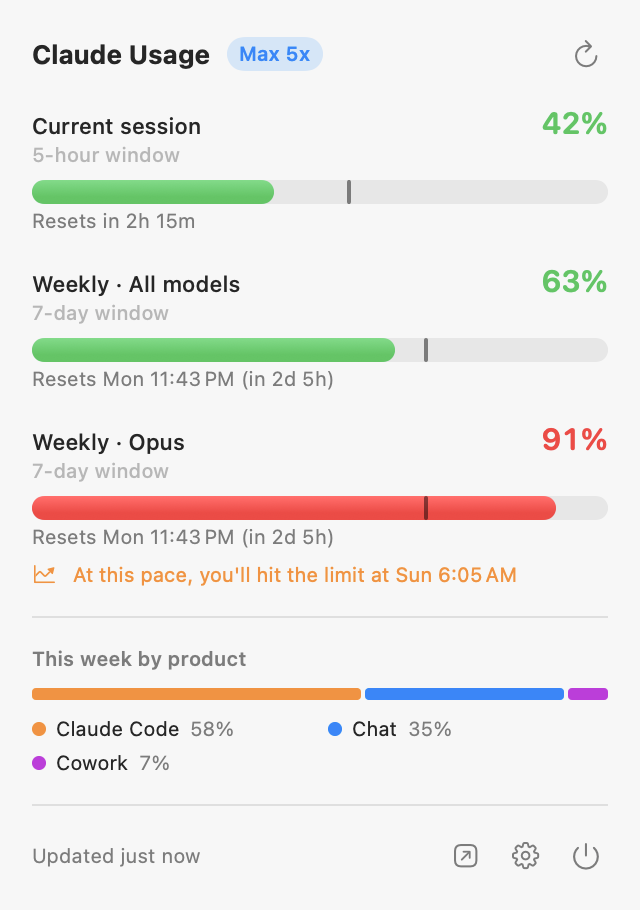
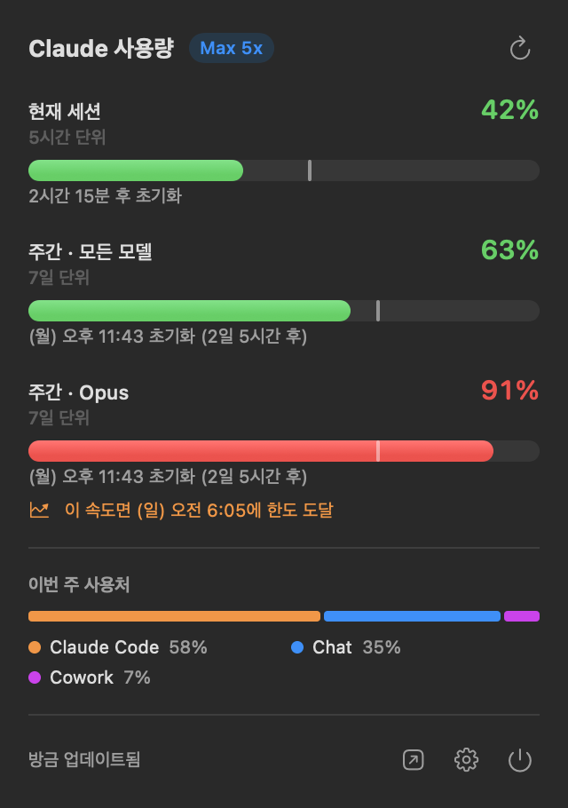
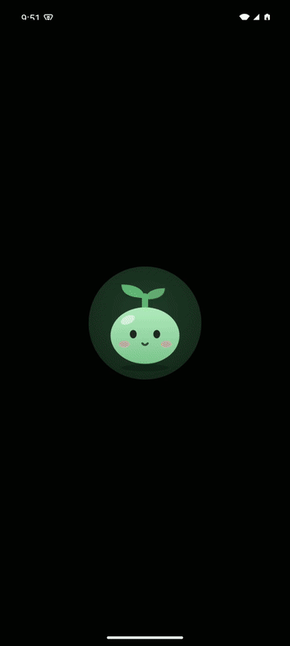

<div align="center">



# Kongi (콩이)

**노치 없는 Mac을 위한 다이나믹 아일랜드.**<br>
맥 미니, 맥 스튜디오, 아이맥처럼 노치가 없는 Mac과 외장 모니터를 위해 만들었어요. 맥북에서도 쓸 수 있어요.<br>
화면 맨 위에서 Claude Code를 지켜보고 조종하고, 메뉴 막대에서 Claude 한도를 보고, 음악·에어팟·알림을 아이폰처럼 띄워요.

[](https://github.com/eocnd36/Kongi/releases/latest/download/Kongi.zip)
&nbsp;
[](https://github.com/eocnd36/Kongi/releases/latest/download/Kongi.apk)
&nbsp;
[](https://eocnd36.github.io/Kongi/?lang=ko)

[English](README.md) · **한국어**



<sub>▶ 소리와 내레이션이 있는 영상: <a href="https://eocnd36.github.io/Kongi/?lang=ko#demo">웹사이트에서 보기</a></sub>

</div>

## 왜 Kongi인가요

노치가 있는 맥북은 다이나믹 아일랜드가 자리 잡기 좋아요. 하지만 **노치가 없는 맥 미니, 맥 스튜디오, 아이맥과 외장 모니터는 메뉴 막대가 평평해요.** Kongi는 이런 화면을 위해 먼저 만들었어요. 아일랜드는 화면 맨 위 가운데에 조용히 떠 있다가, 마우스를 올리거나 확인할 일이 생기면 펼쳐져요.

**앞으로:** 맥북에서도 지금 쓸 수 있고, 노치에 맞춘 맥북용 업데이트를 준비하고 있어요. 휴대폰 앱은 안드로이드부터 시작했고, 아이폰 앱도 만들 계획이에요.

## 이런 앱이에요

### 아일랜드: Claude Code를 화면 맨 위에서

| | |
| --- | --- |
| **실시간 보기** | Claude가 무엇을 읽고, 실행하고, 고치는지 그대로 보여 줘요. 고치는 코드는 한 글자씩 써지고, 읽는 파일은 줄이 차례로 나타나고, 명령은 출력이 보이며, 단계는 줄기를 따라 자라요. |
| **승인과 질문** | 권한 요청에 허용 · 거부 · 항상 허용으로 답하고, Claude의 선택형 질문(단일·복수 선택, 직접 입력)에도 하던 일을 멈추지 않고 답해요. |
| **대화** | 표·목록·코드 블록까지 마크다운 그대로 대화를 읽고, 같은 세션에 아일랜드에서 바로 이어서 말해요. |
| **코드 변경** | 바뀐 파일과 +N / −N, diff를 보여 줘요. |
| **터미널로 이동** | Terminal · iTerm은 정확한 탭으로, Warp · Ghostty · VS Code 등은 앱을 앞으로 가져와요. |
| **초기화되면 이어서** | 한도에 닿으면 버튼 하나로, 한도가 초기화되는 순간 대화를 이어서 해요. 원하는 프롬프트를 예약할 수도 있어요. |

<p align="center">&nbsp;&nbsp;</p>

### 더 많은 일을 하는 다이나믹 아일랜드

- Apple Music · Spotify **음악** (앨범 아트와 재생 조작)
- **에어팟·헤드폰** 연결과 배터리, **볼륨**, **충전**, **배터리 부족**
- 작업 완료, 명령 종료, 곧 시작하는 회의 **소식**
- **집중 타이머**, **시스템 상태**, GitHub, 로컬 서버, 클립보드 도구
- 아이폰처럼 음악과 Claude Code를 **나란히**

### 콩이를 소개해요

콩이는 아일랜드에 사는 새싹 강낭콩이에요. Claude가 하는 일에 따라 읽고, 고치고, 명령을 실행하고, 찾고, 생각하고, 기다리고, 기뻐하고, 명령이 실패하면 조금 시무룩해져요. 쉴 때는 두리번거리고 하품하며, 하루 동안 Claude를 쓸수록 잎이 자라고 꽃도 피어요. 콩이를 누르면 하트가 떠올라요.

<p align="center"></p>

### 메뉴 막대의 Claude 사용량

5시간 세션과 주간 한도를 시계 옆에 (`42% · 63%`). 메뉴 막대 표시를 아예 숨기고 아일랜드만 쓸 수도 있어요. 초기화까지 남은 시간, 페이스 눈금, 한도 도달 예측, 원하는 사용률 알림, 초기화 알림, Claude 장애 알림. 11개 언어를 지원해요.

<p align="center">&nbsp;&nbsp;</p>

### 안드로이드용 Kongi (아이폰은 나중에)

Mac과 같은 Wi-Fi에서 휴대폰으로 승인 요청에 답하고, 세션을 실시간으로 따라가고, 대화를 읽고 메시지를 보내요. QR 코드를 한 번만 찍으면 연결돼요. 휴대폰과 Mac 사이의 모든 내용은 두 기기에만 있는 키로 암호화되고, 중간 서버는 없어요.

<p align="center"></p>

## 설치

> 필요한 것: **macOS 13 이상**, Claude Pro · Max · Team 계정으로 로그인된 **[Claude Code](https://docs.claude.com/en/docs/claude-code/setup)**

1. **[Kongi.zip 내려받기](https://github.com/eocnd36/Kongi/releases/latest/download/Kongi.zip)** → 압축을 풀고 `응용 프로그램` 폴더로 옮겨요.
2. 처음 열 때 막히면 **시스템 설정 → 개인정보 보호 및 보안 → 그래도 열기**를 누르거나 아래 명령을 실행하세요. (Apple 공증을 받지 않은 오픈소스 빌드라서 나오는 경고예요.)
   ```sh
   xattr -dr com.apple.quarantine /Applications/Kongi.app
   ```
3. 메뉴 막대 게이지를 클릭하고 **연결**을 누르면 사용량이 보여요.
4. 아일랜드를 쓰려면 **설정 → Claude Code → 연결**을 누르고 Claude Code를 새로 시작하세요.

**업데이트:** Kongi가 GitHub에서 새 버전을 확인해 아일랜드로 알려 줘요. 설정 → 정보에서 **지금 업데이트**를 누르면 알아서 바뀌고 다시 열려요. 내려받은 파일은 서명을 확인한 뒤에만 설치해요.

**안드로이드 (선택):** 휴대폰에서 **[Kongi.apk](https://github.com/eocnd36/Kongi/releases/latest/download/Kongi.apk)**를 내려받아 설치를 허용하세요. Mac의 **설정 → 휴대폰**에서 연결을 켜고 QR 코드를 찍으면 돼요. 안드로이드 8 이상.

## 개인정보와 안전

- **사용량:** Claude Code 로그인을 읽기만 하고 바꾸지 않아요. 토큰은 `api.anthropic.com`에만 보내고, 그 밖에는 공개 상태 페이지만 확인해요. 분석 도구는 없어요.
- **아일랜드:** Claude Code 훅이 Mac 안의 로컬 소켓으로 Kongi에 전달해요. 연결할 때 `~/.claude/settings.json`을 먼저 백업하고, 직접 넣은 설정은 그대로 두며, 연결을 지울 때도 Kongi 항목만 지워요. Kongi가 꺼져 있으면 Claude Code는 평소처럼 동작해요.
- **휴대폰 연결:** 직접 켜기 전에는 꺼져 있어요. 같은 네트워크의 기기만 접속할 수 있고, 모든 내용은 QR 코드의 키로 AES-256-GCM 암호화되며, 같은 요청을 다시 보내는 공격은 거절해요.
- **Claude 사용량:** Kongi를 켜 둔다고 사용량이 들지 않아요. 예약하거나 보낸 프롬프트만 직접 입력한 것과 똑같이 사용량이 들어요.

## 문제 해결

| 증상 | 해결 |
| --- | --- |
| Claude Code 로그인 정보가 없어요 | 터미널에서 `claude`를 실행해 로그인하세요. |
| 로그인이 만료됐어요 | `claude`를 한 번 실행하면 Kongi가 다음 새로고침 때 복구돼요. |
| 아일랜드에 세션이 안 보여요 | 설정 → Claude Code를 확인하고 Claude Code를 새로 시작하세요. |
| 휴대폰이 Mac을 못 찾아요 | 같은 Wi-Fi인지, 휴대폰 연결이 켜져 있는지, macOS의 로컬 네트워크 질문에 **허용**을 눌렀는지 확인하세요. |
| 알림이 안 와요 | 시스템 설정 → 알림에서 Kongi를 켜고 설정에서 테스트 알림을 보내 보세요. |
| 터미널로 이동이 안 돼요 | 처음 한 번 "Kongi가 Terminal을 제어하려고 합니다"를 허용해야 해요. |

---

<sub>비공식 프로젝트이며 Anthropic과 관련이 없습니다. Claude는 Anthropic의 상표입니다. Kongi는 예고 없이 바뀔 수 있는 비공개 API를 사용합니다. [MIT 라이선스](LICENSE) · [서드파티 고지](THIRD_PARTY_NOTICES.md)</sub>
