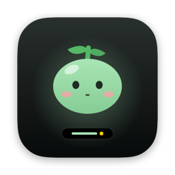
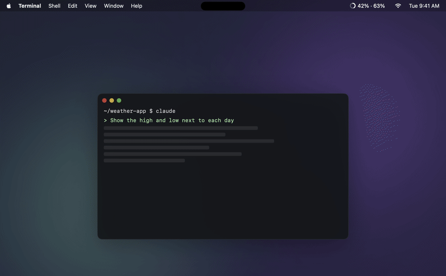
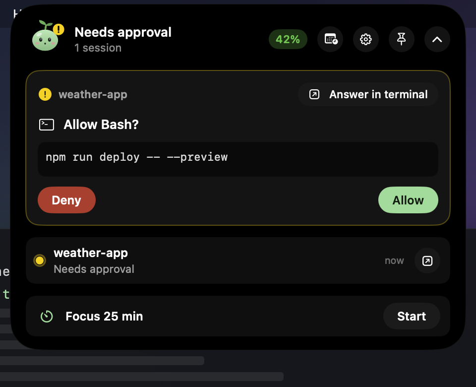
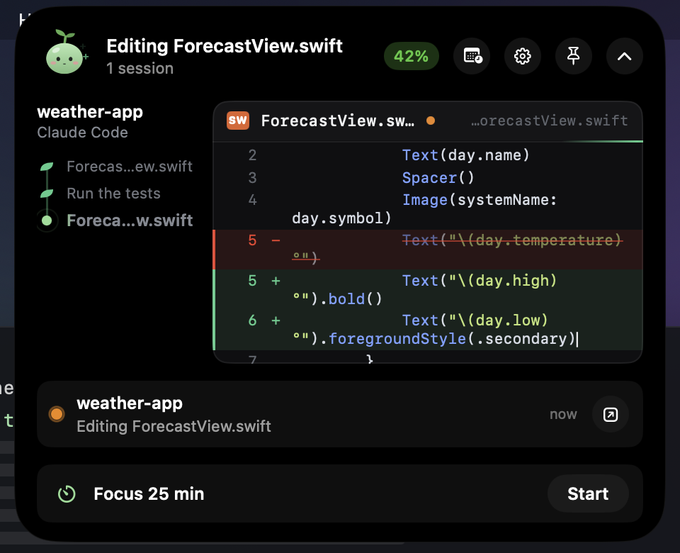
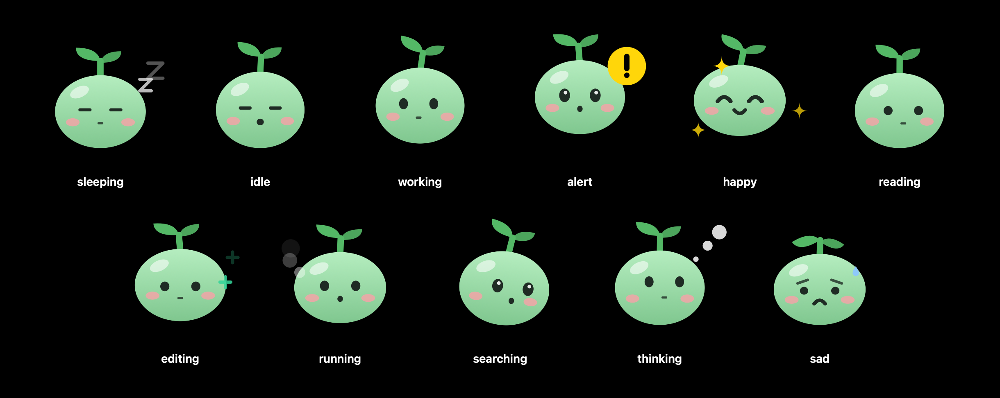
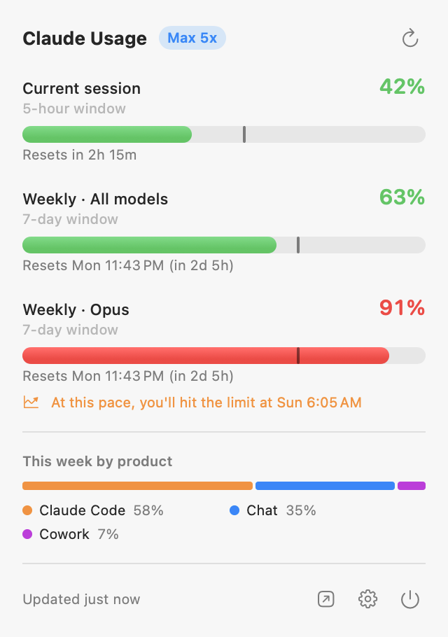
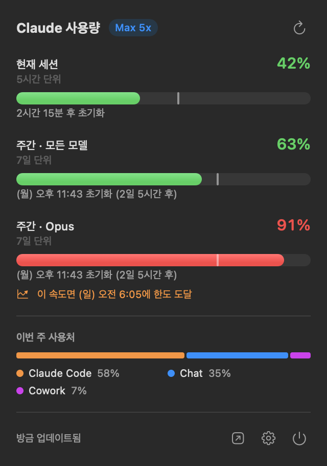
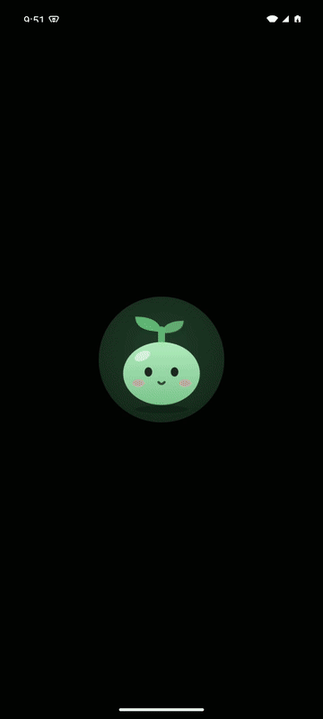

<div align="center">



# Kongi

**A Dynamic Island for Macs without a notch.**<br>
Made for Macs without a notch, like Mac mini, Mac Studio and iMac, and for external displays. It runs on MacBooks too.<br>
Watch and steer Claude Code from the top of your screen, keep your Claude limits in the menu bar, and see music, AirPods and alerts pop in like on iPhone.

[](https://github.com/eocnd36/Kongi/releases/latest/download/Kongi.zip)
&nbsp;
[](https://github.com/eocnd36/Kongi/releases/latest/download/Kongi.apk)
&nbsp;
[](https://eocnd36.github.io/Kongi/)

[](https://github.com/eocnd36/Kongi/actions/workflows/ci.yml)


[](LICENSE)

**English** · [한국어](README.ko.md)



<sub>▶ With sound and narration: <a href="https://eocnd36.github.io/Kongi/#demo">watch the video</a></sub>

</div>

## Why Kongi

Notched MacBooks have a natural home for a Dynamic Island. **Macs without a notch don't** — Mac mini, Mac Studio and iMac have a flat menu bar, and so do external displays. Kongi was made for those screens first: the island floats at the top center of the display, stays out of the way, and opens when you hover or when something needs you.

**What's next:** Kongi already runs on MacBooks, and an update tuned for the notch is planned. The phone app starts on Android, and an iPhone app is on the way.

## What it does

### The island: Claude Code at the top of your screen

| | |
| --- | --- |
| **Live view** | See exactly what Claude reads, runs and edits. Code being written types itself out, files being read scroll in, commands show their output, and every step grows along a little stem. |
| **Approvals and questions** | Allow, Deny or Always for permission requests, and answer Claude's multiple-choice questions (single, multi-select or your own words) without leaving what you're doing. |
| **Conversation** | Read the conversation with full Markdown — tables, lists and code blocks — and reply to the same session from the island. |
| **Code changes** | Changed files with +N / −N and a diff view. |
| **Jump to the terminal** | Opens the exact Terminal or iTerm tab; Warp, Ghostty, VS Code and others come to the front. |
| **Continue after a reset** | Hit a limit? One click and Kongi continues the conversation the moment your limit resets. You can also schedule any prompt. |

<p align="center">&nbsp;&nbsp;</p>

### A Dynamic Island that does more

- **Music** from Apple Music and Spotify, with artwork and controls
- **AirPods and headphones** connecting with battery levels, **volume**, **charging** and **low battery**
- **Notices** when a task finishes, a command ends or a meeting is about to start
- **Focus timer**, **system stats**, GitHub, local servers and clipboard tools
- Music and Claude Code **side by side**, like on iPhone

### Meet Kongi

Kongi is a bean sprout who lives in the island and reacts to what Claude is doing: reading, editing, running commands, searching, thinking, waiting for you, celebrating, or looking a little sad when a command fails. Idle Kongi looks around and yawns, and grows leaves (and a flower) as you use Claude through the day. Tap Kongi for a heart.

<p align="center"></p>

### Claude usage in the menu bar

Your 5-hour session and weekly limits next to the clock (`42% · 63%`) — or hide the menu bar item entirely and use the island alone. Reset countdowns, a pace marker, a projection of when you'll hit the limit, alerts at the percentages you choose, reset reminders and Claude outage alerts. In 11 languages.

<p align="center">&nbsp;&nbsp;</p>

### Kongi for Android (iPhone coming later)

Approve requests from a notification, follow every session live, read the conversation and send a message — from your phone, over the same Wi-Fi as your Mac. Pair once with a QR code. Everything between the phone and the Mac is end-to-end encrypted with a key that never leaves your devices; there's no server.

<p align="center"></p>

## Install

> Requires **macOS 13 or later** and **[Claude Code](https://docs.claude.com/en/docs/claude-code/setup)** signed in with a Claude Pro, Max or Team plan.

1. **[Download Kongi.zip](https://github.com/eocnd36/Kongi/releases/latest/download/Kongi.zip)**, unzip it and move Kongi to Applications.
2. If macOS blocks the first launch, choose **Open Anyway** in System Settings → Privacy & Security, or run:
   ```sh
   xattr -dr com.apple.quarantine /Applications/Kongi.app
   ```
   (Kongi is an open-source build without Apple notarization.)
3. Click the gauge in the menu bar and press **Connect** to see your usage.
4. For the island, open **Settings → Claude Code → Connect**, then start a new Claude Code session.

**Updates:** Kongi checks GitHub for new versions and tells you in the island. Press **Update now** in Settings → About and it updates and reopens itself. Every download is checked against a signature before anything is replaced.

**Android (optional):** download **[Kongi.apk](https://github.com/eocnd36/Kongi/releases/latest/download/Kongi.apk)** on your phone and allow installing from your browser. On the Mac, open **Settings → Phone**, turn on the phone link and scan the QR code. Android 8 or later.

## Privacy and safety

- **Usage:** Kongi only reads the Claude Code login and never changes it. The token goes only to `api.anthropic.com`; the only other request is the public status page. No analytics.
- **Island:** Claude Code hooks talk to Kongi through a local socket on your Mac. Connecting backs up `~/.claude/settings.json` first, leaves your own settings alone, and removing the connection takes out only Kongi's entries. If Kongi isn't running, Claude Code works as usual.
- **Phone link:** off until you turn it on. Only devices on your local network can reach it, every message is sealed with AES-256-GCM using the key from the QR code, and replays are rejected.
- **Your Claude usage:** running Kongi uses none. Only prompts you schedule or send use usage, exactly like typing them yourself.

<details>
<summary><b>Why doesn't Kongi sign in to Claude itself?</b></summary>

OAuth sign-in for Claude subscriptions is meant for Anthropic's own apps. A third-party app imitating Claude Code to sign in could put your account at risk, so Kongi only reads the Claude Code login you already have.
</details>

## Troubleshooting

| Problem | Fix |
| --- | --- |
| No Claude Code login found | Run `claude` in Terminal and sign in. |
| Login expired | Run `claude` once; Kongi recovers on its next refresh. |
| No sessions in the island | Check Settings → Claude Code, then start a new Claude Code session. |
| The phone can't find the Mac | Same Wi-Fi on both, the phone link turned on, and **Allow** on macOS's Local Network prompt. |
| No notifications | Turn on Kongi in System Settings → Notifications and send a test notification from Settings. |
| Jumping to the terminal doesn't work | Allow "Kongi wants to control Terminal" the first time. |

## Development

Needs Xcode 16 or the Command Line Tools (Swift 6). The Android app builds with `make apk` (the SDK is downloaded into `.tools/`).

```sh
make run         # build and launch the .app
make test        # localization check + unit tests
make universal   # Apple silicon + Intel build → dist/
make apk         # Android APK → dist/
```

```
Sources/ClaudeUsageCore/   Logic without UI: usage API, hooks, diffs, Markdown, phone link crypto (tested)
Sources/ClaudeUsageBar/    The Mac app: menu bar, island, Kongi, scheduled prompts, phone link
Sources/ClaudeUsageHook/   Claude Code hook helper
android/                   Kongi for Android (Kotlin, Jetpack Compose)
site/                      Website (GitHub Pages)
```

---

<sub>Unofficial project, not affiliated with Anthropic. Claude is a trademark of Anthropic. Kongi relies on undocumented APIs that may change without notice. [MIT License](LICENSE) · [Third-party notices](THIRD_PARTY_NOTICES.md)</sub>
